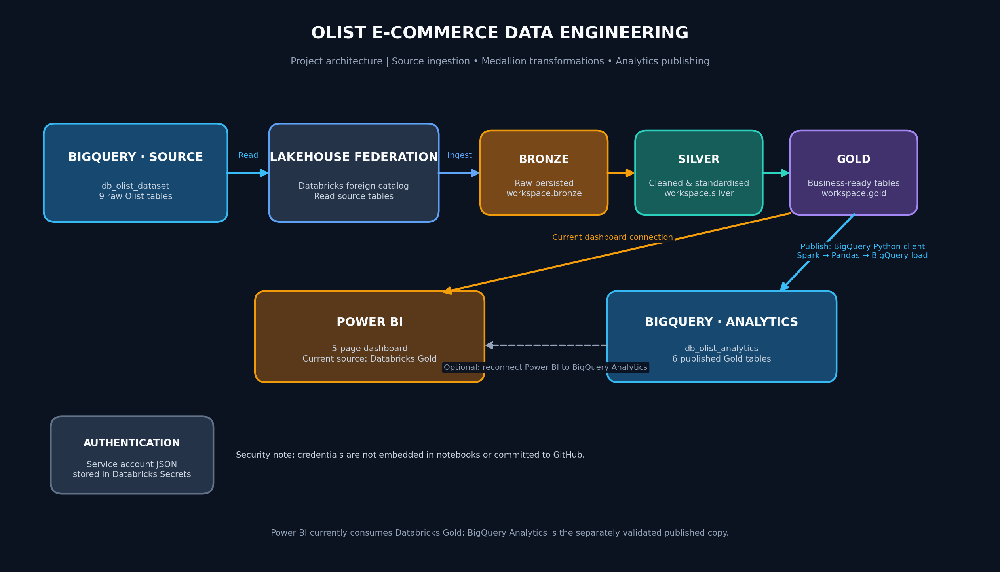

# Olist E-commerce Data Engineering Project

An end-to-end data engineering and analytics project using the Brazilian Olist e-commerce dataset. The project uses **BigQuery as the raw data source**, **Databricks and PySpark for Medallion transformations**, a separate **BigQuery analytics dataset** for publishing curated Gold tables, and **Power BI** for reporting.

> This is a hands-on portfolio project. The repository includes the original development notebook as well as a revised, more organised notebook. The original version is retained to show the practical development process.

## Architecture



**Data flow**

1. Raw Olist tables are stored in BigQuery.
2. Databricks reads the source tables through Lakehouse Federation.
3. Data is persisted and transformed through Bronze, Silver and Gold layers.
4. Six Gold tables are published to a separate BigQuery analytics dataset using the BigQuery Python client.
5. The existing five-page Power BI dashboard consumes Databricks Gold tables.

Power BI currently connects to Databricks Gold. The BigQuery analytics dataset is a separately published and validated copy; the dashboard has not been migrated to BigQuery.

## Technology stack

- **Cloud data warehouse:** Google BigQuery
- **Data engineering:** Databricks, Apache Spark, PySpark, Spark SQL
- **Data architecture:** Medallion architecture (Bronze, Silver, Gold)
- **Data integration:** Databricks Lakehouse Federation; BigQuery Python client
- **Analytics and visualisation:** Power BI
- **Languages:** Python, SQL

## Dataset

The project uses the Olist Brazilian e-commerce dataset, containing data about customers, orders, order items, payments, reviews, products, sellers, geolocation and product-category translations.

The raw source dataset in BigQuery is `db_olist_dataset`. The curated destination dataset is `db_olist_analytics`, in Google Cloud project `databricksproject-510805`.

## Medallion pipeline

### Bronze

- Read the nine source tables from the BigQuery foreign catalog.
- Persist source tables in Databricks under `workspace.bronze`.
- Keep the Bronze layer as the starting point for downstream transformations.

### Silver

Examples of cleaning and standardisation performed:

- Standardised customer city and state labels.
- Normalised common city-name variants in geolocation and seller data using mapping dictionaries.
- Standardised payment method labels.
- Derived an order cancellation-stage field from order status and lifecycle timestamps.
- Joined product data with the English product-category translation table.
- Cast product descriptive and physical attributes to numeric types and filled selected descriptive nulls.
- Persisted the cleaned datasets under `workspace.silver`.

### Gold

Six analytical tables were created under `workspace.gold`:

| Gold table | Grain | Purpose |
|---|---|---|
| `gold_sales` | One row per order item | Sales, product, seller and order-level analysis |
| `gold_customers` | One row per `customer_unique_id` | Customer purchasing metrics |
| `gold_product` | One row per `product_id` | Product sales and review-related metrics |
| `gold_delivery` | One row per order | Delivery duration and delay analysis |
| `gold_order_payments` | One row per order | Order-level payment summary |
| `gold_payment_methods` | One row per order and payment type | Payment-method analysis |

See [`docs/data_dictionary.md`](docs/data_dictionary.md) for table details and [`docs/transformations.md`](docs/transformations.md) for the transformation logic.

## Publishing Gold tables to BigQuery

The six Databricks Gold tables are published to:

`databricksproject-510805.db_olist_analytics`

The implemented publishing flow:

1. Retrieve the Google service-account JSON from Databricks Secrets.
2. Create Google service-account credentials and a BigQuery client.
3. Read a Gold table as a Spark DataFrame.
4. Convert the DataFrame to Pandas using `toPandas()`.
5. Load the Pandas DataFrame into the matching BigQuery table with `load_table_from_dataframe`.
6. Use `WRITE_TRUNCATE` for the destination table load.

A Spark BigQuery connector approach was considered but was not used in this Databricks Free Edition/serverless project.

## Validation

The following checks were completed after publishing:

- BigQuery row counts matched the expected Databricks Gold row counts for all six tables.
- The expected unique keys were checked for duplicates in all six Gold tables.
- Total sales revenue (`ROUND(SUM(price), 2)`) matched between Databricks Gold and BigQuery `gold_sales`.

See [`docs/data_validation.md`](docs/data_validation.md) for the recorded results and validation scope.

## Power BI dashboard

The Power BI report contains five pages:

1. Executive Overview
2. Customer Analysis
3. Product Analysis
4. Delivery Analysis
5. Payment Analysis

The dashboard currently uses Databricks Gold as its data source. Add the `.pbix` file and dashboard screenshots to the `powerbi/` folder when preparing the public repository.

## Repository structure

```text
olist-ecommerce-data-engineering/
├── README.md
├── architecture/
│   └── olist_project_architecture.png
├── notebooks/
│   ├── Olist_Databricks_Medallion.ipynb
│   └── Olist_Databricks_Medallion_Revised.ipynb
├── docs/
│   ├── data_dictionary.md
│   ├── transformations.md
│   └── data_validation.md
├── powerbi/
│   ├── olist_dashboard.pbix
│   └── screenshots/
└── .gitignore
```

## Running / adapting the project

This repository documents the pipeline and transformations. To run it in your own environment:

1. Set up a Google Cloud project and enable the required BigQuery APIs.
2. Make the Olist source tables available in a BigQuery dataset.
3. Configure Databricks Lakehouse Federation to read the source dataset.
4. Create the required Databricks schemas and run the notebook sections in order.
5. Configure a service account with the required BigQuery permissions.
6. Store credentials securely in Databricks Secrets. Do not hardcode credentials in notebooks.
7. Install `google-cloud-bigquery` in the Databricks environment and run the Gold publishing section.
8. Update the Power BI connection for your own environment if you want to reproduce the report.

Resource names and paths in the notebooks are specific to the original project environment and may need to be changed.

## Security

**Never commit** service-account JSON keys, personal access tokens, passwords, `.env` files or other credentials. The service-account key used by the project is stored in Databricks Secrets and is not included in this repository.

## Documentation

- [Gold data dictionary](docs/data_dictionary.md)
- [Transformation details](docs/transformations.md)
- [Data validation results](docs/data_validation.md)
